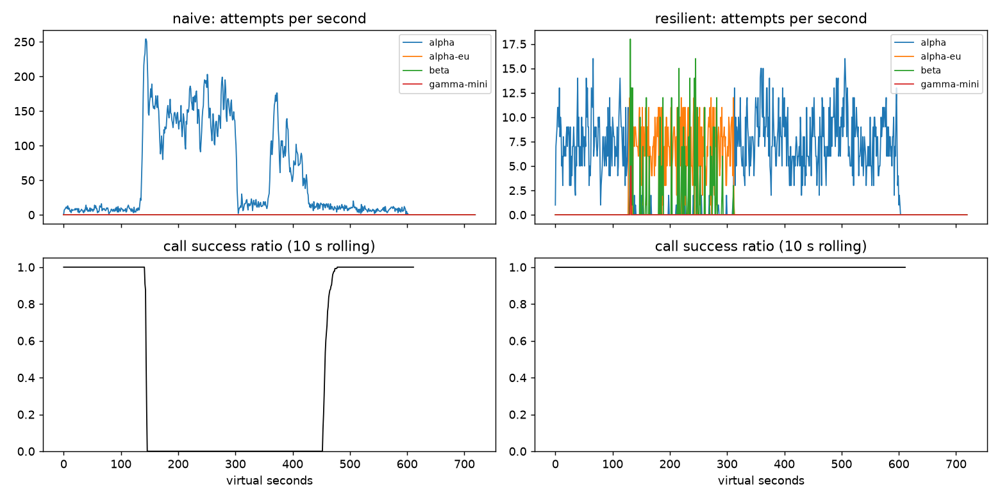

# Lab 25B — Report

**Họ tên / nhóm:** Từ Hoàng Giang — 2A202602363  **Commit:** (điền sau khi commit)  **Điểm tự động (`make grade`):** 84.0 / 88

## 1. Kết quả Game Day (naive vs của bạn)

| Băng | Client | availability | p95 (s) | amplification | retry_ratio | cost/turn | recovery (s) | PASS? |
|---|---|---:|---:|---:|---:|---:|---:|:---:|
| G1 | naive | 0.7194 | 7.157 | 7.738 | 6.738 | 2.163 | 4.0 | No |
| G1 | yours | 1.0000 | 4.792 | 1.065 | 0.002 | 2.090 | 0.0 | Yes |
| G2 | naive | 0.4560 | 15.034 | 9.904 | 8.904 | 4.627 | 155.0 | No |
| G2 | yours | 1.0000 | 5.049 | 1.020 | 0.004 | 2.080 | 0.0 | Yes |
| G3 | naive | 1.0000 | 4.768 | 1.164 | 0.164 | 2.328 | 0.0 | No |
| G3 | yours | 1.0000 | 4.720 | 1.040 | 0.017 | 2.112 | 0.0 | Yes |
| G4 | naive | 1.0000 | 13.764 | 1.004 | 0.004 | 2.008 | 0.0 | No |
| G4 | yours | 1.0000 | 5.654 | 1.032 | 0.004 | 2.107 | 0.0 | Yes |
| G5 | naive | 0.3699 | 5.359 | 17.030 | 16.030 | 2.124 | null | No |
| G5 | yours | 0.8179 | 5.481 | 1.003 | 0.003 | 2.504 | null | Yes |
| G6 | naive | 0.5170 | 4.836 | 12.344 | 11.344 | 2.009 | 0.0 | No |
| G6 | yours | 1.0000 | 6.138 | 1.062 | 0.024 | 2.180 | 0.0 | Yes |

## 2. Cấu hình client và lý do

| Tham số | Giá trị | Vì sao (dựa trên băng nào, số liệu nào) |
|---|---:|---|
| attempt_timeout_s | 6.0 | G6 hoàn tất availability 1.0000; bản thử timeout 30 s giảm còn 0.9488 và có 107 `deadline` give-up. |
| max_attempts_per_provider | 2 | Một retry giữ lỗi đơn lẻ ở provider, trong khi G5 vẫn có `unneeded_failovers=0` và amplification 1.003. |
| backoff_base_s / cap_s | 0.25 / 4.0 | Jitter giữ G1 có 0 vi phạm retry-after và amplification 1.065. |
| retry_budget_ratio | 0.05 | G3 đạt retry ratio 0.017 (ngưỡng 0.10). Khi breaker bị vô hiệu, tắt budget làm retry ratio của G3 tăng từ 0.028 lên 0.159 và amplification của G2 từ 1.365 lên 2.744. |
| breaker.window_size / min_calls | 20 / 10 | Có đủ quan sát trước khi trip nhưng G2 vẫn recovery 0.0 s và amplification 1.020. |
| breaker.failure_rate_threshold | 0.5 | Không coi 400 là health failure: G5 có 0 client-error retry và 0 failover không cần thiết. |
| breaker.slow_call_s | 3.0 | Bắt degradation trước khi p95 xấu; G4 p95 giảm từ 13.764 xuống 5.654 s. |
| breaker.open_duration_s | 10.0 | Probe phục hồi đủ nhanh để G2 và G6 đều đưa primary share sau sự cố về 1.0. |
| breaker.half_open_max_probes | 2 | Giới hạn thử nghiệm lúc hồi phục, tránh herd; mọi băng đều pass seed 25–27. |

Sơ đồ quyết định của `on_error`:

| Loại lỗi | Ghi breaker? | Retry cùng provider? | Failover? | Cooldown |
|---|---|---|---|---|
| 400/401/403/404/422 | không, release | không | không, `GiveUp` | không |
| 429 insufficient_quota | không, release | không | có ngay | `quota_cooldown_s`, dùng chung |
| 429 rate limit | không, release | không | có ngay | đến `now + retry_after`, dùng chung |
| 500/502/504, 503/529, timeout | `on_failure` | có nếu còn lượt, budget và deadline | nếu không retry được | không |
| Hết ladder | — | — | đợi cooldown rate-limit ngắn nhất ≤ 5 s nếu kịp deadline, nếu không `GiveUp` | — |

## 3. Ba thí nghiệm

1. **Retry budget là lớp phòng thủ cuối.** Với breaker bị vô hiệu (`min_calls=10^9`) và tối đa 5 attempt/provider, budget còn bật giữ G2 ở availability 1.0000, amplification 1.365 và recovery 0.0 s; G3 retry ratio là 0.028. Tắt budget làm G2 rơi còn availability 0.6804, amplification 2.744, không hồi phục trong băng và primary share 0.788; G3 retry ratio thành 0.159. Breaker phản ứng với sức khỏe từng provider, còn budget giới hạn tổng retry toàn hệ thống, nên cần cả hai lớp.
2. **Timeout 30 giây.** Ở G4, 30 s vẫn có p95 5.608 s và availability 1.0000 vì breaker nhanh chóng chuyển traffic. Nhưng ở G6 availability giảm từ 1.0000 xuống 0.9488, với 107 `deadline` và 15 `no_provider_available` give-up: chờ quá lâu làm mất thời gian failover. Vì vậy timeout cần dựa vào latency lúc provider khỏe và deadline user, không chỉ nhìn p95 thành công.
3. **Bỏ lọc tool calling.** G6 có 248 `incompatible_routes`, availability giảm từ 1.0000 xuống 0.8960, và 248 lượt bị `incompatible_model_output`. Theo góc nhìn sản phẩm, 248 khách đã nhận câu trả lời không thể thực hiện thao tác hoàn tiền vì model được chọn không gọi được tool.

## 4. Workflow hoàn tiền

| Executor | completion | crashes | duplicate refunds | duplicate emails | lost refunds | overpaid | wasted LLM / crash |
|---|---:|---:|---:|---:|---:|---:|---:|
| naive | 1.000 | 81 | 128 | 81 | 0 | 1574200 | 1.123 |
| yours | 1.000 | 66 | 0 | 0 | 0 | 0 | 0.303 |

Idempotency key một mình chưa đủ: worker mới sau crash vẫn chạy lại các bước không có key và nếu key không ổn định theo `(session, step)`, payment có key mới sẽ bị thực hiện lần hai. Checkpoint một mình cũng chưa đủ: worker có thể chết sau khi payment thành công nhưng trước khi checkpoint được ghi; lần sau vẫn gọi payment. Vì vậy implementation dùng key ổn định cho side effect và ghi checkpoint chỉ sau khi từng step hoàn thành. Nếu ghi checkpoint trước payment, crash giữa hai thao tác sẽ làm worker sau bỏ qua một refund chưa từng xảy ra.

## 5. Alerting & error budget

| Sự cố | Mong đợi | Naive alerter | Burn-rate alerter | Độ trễ phát hiện (phút) |
|---|---|---|---|---:|
| checkout_bug | page | page | page | 27 |
| provider_outage | page | page | page | 4 |
| deploy_blip | none | false page | none | — |
| slow_leak | ticket | missed | ticket | 1337 |
| degraded_evening | page | page | page | 291 |
| night_spike | none | false page | none | — |
| small_bump | none | false page | none | — |

Trong 30 ngày, 25,901,755 request dùng 55,618 bad request trên budget 129,508.8: đã tiêu 42.95%, còn 57.05%, nên chưa đóng băng release. `small_bump` có 1,794 lỗi trong 20 phút, tương đương 1.385% budget tháng; nó không đạt ngưỡng burn rate 14.4×/6×, tự kết thúc trước khi budget có nguy cơ cạn nhanh. Page tại 11 giờ trưa cho mẫu này chỉ tạo alert fatigue.

## 6. Postmortem — Băng G2 với client naive (blameless)

**Tóm tắt:** G2 làm `alpha` mất 75% năng lực từ t=120 đến t=300. Naive client có availability 0.4560, amplification 9.904 và chỉ hồi phục sau 155 giây kể từ lúc provider đã hồi phục. Client đã sửa đạt availability 1.0000, amplification 1.020 và recovery 0.0 s.

**Ảnh hưởng:** 1,285 trong 2,362 lượt user thất bại. Có 328 giây mà success ratio trong cửa sổ trượt 10 giây dưới 0.95. Với 51,840 lỗi được phép/tháng, sự cố tiêu 2.479% error budget tháng.

| t | Sự kiện | Bằng chứng (số) |
|---:|---|---|
| 110–119 | Trước sự cố | 9.1 attempts/s; success ratio 1.000 |
| 120 | `alpha` mất 75% năng lực | Trigger bắt đầu; khung 120–129 còn 6.2 attempts/s, success ratio 1.000 do hàng đợi chưa dâng |
| 140–149 | Retry storm đạt đỉnh | 214.2 attempts/s; success ratio 0.000 |
| 200–209 | Giữa sự cố | 133.3 attempts/s; success ratio 0.000 |
| 290–299 | Ngay trước restore | 146.1 attempts/s; success ratio 0.000 |
| 300–309 | Provider hồi phục nhưng client chưa hồi phục | 38.8 attempts/s; success ratio vẫn 0.000 |
| 310–319 | Lượng attempt đã giảm về gần năng lực của `alpha` (18 slot × ~1.2 s/req ≈ 15 req/s) nhưng không call nào thành công: server vẫn xử lý request mà client đã bỏ | 15.7 attempts/s; success ratio 0.000 |
| 400–409 | Một đợt retry mới bùng lên trước khi hệ thống hồi phục | 77.9 attempts/s; success ratio 0.000 |
| 455 | Cửa sổ hồi phục 30 s đầu tiên đạt ≥0.95 | `recovery_s=155.0`; lần đầu thỏa tiêu chí hồi phục |

**Trigger vs root cause:** Trigger là `alpha` mất năng lực GPU. Root cause là thiết kế client: ba tầng retry chồng nhau, retry cố định 0.2 s không jitter, không retry budget, không breaker, không fallback và không xét deadline. Khi provider chậm, timeout khiến client gửi thêm request trong khi server vẫn làm request cũ; hàng đợi chứa request không còn ai chờ và các request mới bị 529. Sau t=300 năng lực đã trở lại nhưng retry còn giữ tải cao hơn năng lực, nên vòng lặp overload → retry → overload tự duy trì tới t=455. Đây là lỗi của hệ thống và các guardrail còn thiếu, không quy cho cá nhân.

**Điều giúp / làm tệ hơn:** Fallback, cooldown dùng chung, jitter, retry budget và breaker làm G2 repaired giảm attempts từ 34,475 xuống 4,820. Ngược lại, naive client gửi toàn bộ 34,475 attempt vào `alpha`, có 2,737 timeout và 3,194 overload error, khiến chi phí mỗi good turn tăng từ 2.080 lên 4.627. Trong 32,234 lỗi mà naive client nhận ở G2, 26,298 (81.6%) là `429 rate_limit_exceeded`: cơn bão retry đạt 214.2 attempts/s trong khi tenant `alpha` chỉ được 20 rps, và client gửi lại sau 0.2 giây bất chấp `retry-after` (28,381 lần vi phạm). Phần lớn retry vì thế không tới được GPU mà chỉ đốt hết 36 lượt của mỗi call: 655 call bỏ cuộc vì `retries_exhausted` và 585 vì `deadline`.

| # | Hành động | Loại | Owner | Cách kiểm chứng |
|---|---|---|---|---|
| 1 | Giữ retry budget và full-jitter ở một tầng client duy nhất | prevent | Platform Reliability | CI G2: amplification ≤ 1.6 trên seed 25–27 |
| 2 | Thêm dashboard provider-level cho breaker state, retry ratio và amplification | detect | Observability | Canary G2 báo khi amplification > 1.6 hoặc breaker OPEN kéo dài > 10 s |
| 3 | Diễn tập failover và half-open probe hằng tuần | mitigate | On-call Operations | G2 recovery_s ≤ 30 s, primary share sau restore ≥ 0.8 |

## 7. Một điểm yếu còn lại

G6 vẫn tăng cost/turn lên 2.180 khi `beta` gánh nhiều tải, cao hơn 2.080 ở G2 và 2.090 ở G1. Nếu nhiều provider cùng chậm thay vì lỗi rõ ràng, breaker có thể tránh timeout nhưng không thể tạo thêm năng lực. Bước tiếp theo là admission control theo deadline và routing cân nhắc chi phí/capacity, được kiểm chứng bằng một tape nhiều provider chậm đồng thời.

## 8. Cache (Part G)

| Client | availability | faq_availability | cache_hit_ratio | stale_served | wrong_answers | outdated_answers | cost/turn | PASS? |
|---|---:|---:|---:|---:|---:|---:|---:|:---:|
| resilient (không cache) | 0.8390 | 0.8453 | 0.000 | 0 | 0 | 0 | 1.384 | No |
| cached (của bạn) | 0.9124 | 0.9645 | 0.590 | 196 | 0 | 2 | 0.957 | Yes |

| Tham số `cache:` | Giá trị | Vì sao (số liệu nào) |
|---|---:|---|
| similarity_threshold | 0.90 | 0.80 tạo 181 `other_question` wrong answer; 0.97 không sai nhưng hit ratio chỉ 0.499; 0.90 đạt 0 sai và hit 0.590. |
| ttl_s | 30 | TTL 30 có 2 outdated answer và hit 0.590; 60 có 3 outdated/hit 0.653, còn 300 lên 95 outdated dù hit 0.731. |
| max_stale_s | 600 | stale=0 làm FAQ availability còn 0.8506; 600 phục vụ 196 stale response và đạt 0.9645. |

1. **Ngưỡng.** Ở 0.80, C1 trả nhầm 181 câu (`other_question`), availability FAQ chỉ 0.8593 dù hit 0.610. Ở 0.97 không có wrong answer nhưng hit ratio 0.499 dưới ngưỡng. Giá trị 0.90 cân bằng được safety (0 wrong) và hit ratio 0.590. Chỉ các cặp intent mà bộ FAQ đặt sát nhau (cosine ~0.80–0.86) mới đủ gần để vượt ngưỡng 0.80: chính sách hoàn tiền ↔ thời gian nhận tiền hoàn, đổi size ↔ đổi màu, phí ship nội thành ↔ phí ship đi tỉnh, hình thức thanh toán ↔ COD. Người hỏi "bao lâu nhận được tiền hoàn" nhận câu trả lời về điều kiện hoàn tiền — đúng chủ đề, sai câu hỏi.
2. **TTL.** TTL 30/60/300 lần lượt cho outdated 2/3/95 và hit 0.590/0.653/0.731. Webhook đã invalidation tài liệu được thông báo, nhưng không thể biết shipping update im lặng; chỉ tuổi entry giới hạn được câu trả lời outdated.
3. **Stale-if-error.** Với `max_stale_s=0`, FAQ availability là 0.8506, hit ratio 0.476 và không có stale serve. Cửa sổ 600 s nâng FAQ availability lên 0.9645 nhờ 196 câu trả lời stale mà vẫn không trả nhầm.

Câu hỏi cá nhân không được cache vì câu trả lời phụ thuộc dữ liệu của riêng một người và thay đổi theo từng phút (trạng thái đơn, tiền hoàn, điểm). Embedding của hai câu hỏi chỉ khác số đơn giống nhau tới khoảng 0.99, nên ngưỡng similarity nào đủ lỏng để bắt paraphrase cũng sẽ trả đơn hàng của người này cho người khác. Cache theo từng user chặn được rò rỉ giữa các user nhưng không chặn được việc trả cho chính user đó một trạng thái đã cũ, và một câu hỏi mà mỗi người chỉ hỏi vài lần thì gần như không bao giờ hit — rủi ro có thật, lợi ích không có. Trong outage, dashboard không nên chỉ nhìn availability cache: cần alert theo provider error rate/breaker đồng loạt OPEN, tỷ lệ `stale_served`, và availability của lượt không thể cache (personal/tool calls).
